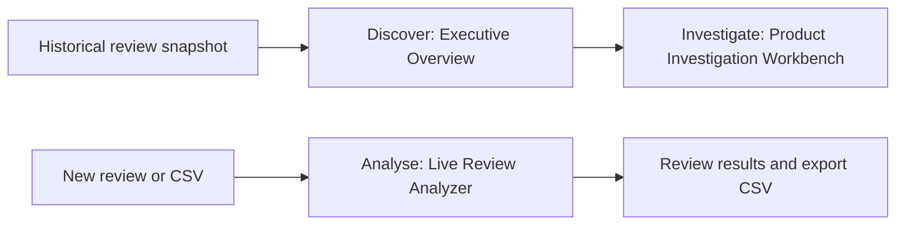

# SignalDesk: AI-Powered Customer Review Intelligence

SignalDesk helps Customer Experience Managers, Product Quality Managers and Retail Operations
Analysts find recurring concerns in appliance reviews. Star ratings summarise satisfaction but
rarely explain what went wrong; reading every review individually makes patterns difficult to see.
Trained sentiment classification, independent complaint detection and historical analytics help
managers prioritise products, inspect original customer evidence and triage incoming feedback.

Developed for **NTU BC3415 Option A — Text Classification**.

**[Run SignalDesk](#quick-start)** · **[Historical data requirements](#historical-dashboard-data-not-included)**

## How SignalDesk Works

### 1. Discover — Executive Overview

Start with review volume, negative-rating burden and complaint patterns to identify products
requiring attention. The historical snapshot contains **22,838 reviews across 80 products**, ending
**11 September 2023**, with **38 investigation candidates**. Search products and open a candidate to
understand the feedback behind its priority.

### 2. Investigate — Product Investigation Workbench

Examine product timelines and compare complaint proportions across supported historical periods.
Rising signals highlight increases; sustained signals highlight repeated burden across two periods.
Check supporting counts, denominators and original excerpts before escalating a customer-reported
concern. Candidates support human investigation; they do not establish defects.

Negative-rating shares use rated reviews; complaint shares use scanned bodies, with minimum support.

### 3. Analyse — Live Review Analyzer

Paste an individual review or upload a UTF-8 CSV with a required `text` column and an optional
`review_id` column. Batches support **up to 100 reviews / 2 MiB** and process each review through
the same saved sentiment model and independent rules, sequentially. Inspect exact complaint excerpts
and export a spreadsheet-safe CSV. **Other / Uncategorised Feedback** flags
negative sentiment where all five complaint scans completed without matching evidence, prompting
manual review.



**Historical analysis and incoming-review analysis are separate processing paths.** CSV uploads do
not update the historical dashboard or create investigation candidates.

For example, a manager can inspect a historical arrival-damage candidate, compare its reporting
periods and read the evidence, then separately analyse a new customer-service CSV and export
results for follow-up. This is an illustrative workflow.

## Quick Start

**The shortest route to a working SignalDesk:** install the prerequisites, run setup once, start two services, then open the local website. No retraining, API key, GitHub sign-in or manual model download is needed.

**What you can use after a public clone:**

| Feature | Available after setup? |
|---|---|
| **Live Review Analyzer** — single review, CSV batch, sentiment and complaint evidence | **Yes** |
| **Executive Overview and Product Investigation Workbench** — populated historical results | **Only after an authorised handoff of four historical files** |

The historical files are not available through a public download link. See [Historical dashboard data (not included)](#historical-dashboard-data-not-included). This restriction does **not** prevent running the Live Review Analyzer.

### Step 1 — Install these programs (once)

Use **Windows 10/11 (64-bit)** and install:

1. [Python 3.13](https://www.python.org/downloads/) — ensure the Windows **Python launcher (`py`)** is installed.
2. [Node.js 24](https://nodejs.org/en/download) — choose the **24.x** release, which includes npm.
3. [Git for Windows](https://git-scm.com/downloads/win).

Open **Windows PowerShell** (not a Python interpreter) and, optionally, confirm the versions:

```powershell
py -3.13 --version
node --version
git --version
```

For the **DistilBERT GPU model**, you also need a compatible NVIDIA GPU and driver (tested on an RTX 4070 Laptop GPU, 8 GB VRAM). **No NVIDIA GPU?** Use the CPU commands below instead. A separate CUDA Toolkit installation is not required.

### Step 2 — Download the project and run setup (once)

Copy this complete block into PowerShell:

```powershell
git clone https://github.com/RohanR2501/signaldesk-bc3415-submission.git
cd signaldesk-bc3415-submission
powershell.exe -NoProfile -ExecutionPolicy Bypass -File .\setup.ps1
```

**If you do not have a compatible NVIDIA GPU**, replace the *last line* with:

```powershell
powershell.exe -NoProfile -ExecutionPolicy Bypass -File .\setup.ps1 -CpuOnly
```

Setup installs locked dependencies, downloads the saved model bundle from the [public model Release](https://github.com/RohanR2501/signaldesk-bc3415-submission/releases/tag/runtime-models-v1), and verifies checksums. It may take a while on the first run. Files already downloaded and verified are reused.

**A warning saying `PARTIALLY REPRODUCIBLE` is expected on a public clone.** It means the *historical dashboards* have no data yet; it does **not** mean the Live Review Analyzer or saved models failed. Continue to Step 3 if setup finishes successfully.

### Step 3 — Start the application (two PowerShell windows)

Keep **both windows open** while using SignalDesk. Both must be in the `signaldesk-bc3415-submission` folder (you can open that folder in File Explorer, click the address bar, type `powershell` and press Enter to start PowerShell there).

**PowerShell window 1 — backend**

```powershell
powershell.exe -NoProfile -ExecutionPolicy Bypass -File .\start.ps1 Backend
```

**CPU mode:** use this backend command instead:

```powershell
powershell.exe -NoProfile -ExecutionPolicy Bypass -File .\start.ps1 Backend -CpuOnly
```

**PowerShell window 2 — frontend** (same command for GPU and CPU):

```powershell
powershell.exe -NoProfile -ExecutionPolicy Bypass -File .\start.ps1 Frontend
```

### Step 4 — Open SignalDesk and check it works

Open **http://127.0.0.1:5173/** in a browser *on that same computer*. The backend API documentation is available at **http://127.0.0.1:8000/docs**.

1. In the sidebar, select **Live Review Analyzer**.
2. Choose **Single Review**, paste `The coffee maker arrived broken and does not turn on.` and run the analysis.
3. Confirm that a sentiment prediction and complaint evidence (when the rules match) appear. The displayed model indicates whether the GPU DistilBERT or CPU Logistic Regression path ran.
4. Optionally, select **Batch CSV Analysis** and upload a UTF-8 `.csv` file with a `text` header (up to 100 reviews / 2 MiB); the results can be filtered and exported.

The first **GPU** prediction may take several minutes while DistilBERT loads; later requests reuse the loaded model. The CPU fallback is a different trained classifier, so its sentiment outputs may differ. To stop the application, press **Ctrl+C** in each service's PowerShell window.

### Historical dashboard data (not included)

**To reproduce the populated historical views exactly as shown in the demonstration, four additional prepared files are required.** They are **not** included in the GitHub repository or model Release and there is currently **no public download link** for them. This is because redistribution permissions for Amazon review-containing material are unresolved.

An authorised handoff must provide these **matching** files, preserving their relative paths under the cloned repository:

```text
data/processed/appliances-v1/investigation.parquet
data/processed/appliances-v1/manifest.json
data/annotations/sentiment-v1/internal/provenance.json
data/annotations/sentiment-v1/complaints-v1/internal/provenance.json
```

Their required sizes and SHA-256 checksums are listed in the [runtime artifact inventory](config/runtime-artifacts.json). After placing authorised copies at those exact paths, verify them:

```powershell
powershell.exe -NoProfile -ExecutionPolicy Bypass -File .\setup.ps1 -VerifyOnly
```

For a CPU-only installation, use `-VerifyOnly -CpuOnly` instead. Restart the backend afterwards if it was already running.

**Where to refer for the original data:** [Amazon Reviews 2023 — official project](https://amazon-reviews-2023.github.io/), [Appliances dataset on Hugging Face](https://huggingface.co/datasets/McAuley-Lab/Amazon-Reviews-2023), and the [maintainers' clarification about data rights](https://huggingface.co/datasets/McAuley-Lab/Amazon-Reviews-2023/discussions/1). These links provide source-data documentation, **not** the four processed runtime files. Downloading the raw dataset alone will not restore the frozen historical dashboard; standalone reconstruction from the public source has not been verified. For access to the exact historical snapshot, contact the project author through the course's existing submission channel to discuss an authorised handoff.

### If something goes wrong

| Symptom | What to do |
|---|---|
| `py`, `node` or `git` not recognised | Install the linked prerequisite, reopen PowerShell and retry Step 1. |
| Setup reports missing historical files | Expected on a public clone; proceed to the **Live Review Analyzer**. See the historical-data section only if full dashboards are needed. |
| GPU unavailable or CUDA error | Repeat setup with `-CpuOnly`, then start the backend with `-CpuOnly`. |
| First prediction appears to stall | Allow time for initial GPU model loading; subsequent predictions should be faster. |
| Port `8000` or `5173` in use | Stop the already-running SignalDesk service with Ctrl+C in its own terminal, or use that existing service. |
| Model download/checksum failure | Check network access and the [model Release](https://github.com/RohanR2501/signaldesk-bc3415-submission/releases/tag/runtime-models-v1); follow the displayed error. No manual replacement of mismatched files is performed. |


## Dataset and Machine Learning

The project uses the **Appliances** category of McAuley Lab's **Amazon Reviews 2023**. Sentiment
targets are rating-derived: **1–2 stars negative, 3 neutral, 4–5 positive**. Only original
review-body `model_text` enters classifiers; ratings, IDs, timestamps and other metadata are
excluded from sentiment features.

Preprocessing validates text, ratings and UTC timestamps, removes reviewer identities and images,
and groups exact and defined near-duplicate text families before selecting one representative per
sentiment family. Chronological splitting approximates prediction on later reviews while preventing
detected duplicate families from crossing partitions. TF-IDF vocabulary/IDF and class weights are
fitted using training data only.

Naive Bayes provides a simple TF-IDF baseline. Logistic Regression learns discriminative word/phrase
weights, with a balanced variant giving minority classes more influence. Two DistilBERT models
fine-tune the same pretrained encoder for two epochs, comparing unweighted loss with training-only
square-root inverse-frequency class weighting.

All models below use the same **6,673 rating-proxy validation reviews**, after reserving 240
annotation records. **Macro-F1** weights the three classes equally during selection, so the large
positive class cannot dominate the overall comparison.

| Model | Validation accuracy | Macro-F1 |
|---|---:|---:|
| Majority class | 76.19% | 0.2883 |
| TF-IDF + Naive Bayes | 78.30% | 0.3569 |
| TF-IDF + Logistic Regression | 87.53% | 0.5680 |
| TF-IDF + balanced Logistic Regression | 82.65% | 0.6269 |
| Unweighted DistilBERT | 89.84% | 0.6669 |
| **Weighted DistilBERT — default CUDA model** | **87.97%** | **0.6756** |

Weighted DistilBERT achieved the highest validation Macro-F1 and remains the provisional GPU model.
Its advantage over unweighted DistilBERT is modest (**0.0087 Macro-F1**), with lower overall
accuracy. Balanced Logistic Regression is the saved CPU fallback. These scores measure rating-proxy
agreement, not independently verified sentiment accuracy. The 6,921-review test set remains sealed.
Separate LLM-generated references and 20 deliberately selected human judgments do not establish
population-level performance.

## Technical Architecture

The **React / strict TypeScript** frontend calls one **FastAPI** backend through `/api/v1`. Saved
sentiment models load locally on demand and are reused. Separate modules handle preparation, offline
training/evaluation and runtime inference. [Canonical Python
contracts](backend/src/signaldesk/contracts.py) define API schemas and generate shared TypeScript
types.

Independent **complaint-rules-v2** scans five categories: **product defect, arrival damage, wrong
item, delivery issue and service/returns**. It preserves exact original-text offsets, handles
negation and records reported resolutions. Positive sentiment can coexist with complaint evidence;
no matching rule means unknown. Rule coverage is not an independently validated defect-detection
rate.

Historical time-series analytics use a cached **Polars** snapshot, calendar comparisons, explicit
denominators and minimum-support rules to prioritise reading. Historical negative-rating burden
comes from ratings, independently of live sentiment inference. Core predictions require no external
LLM service or paid inference API.

```text
backend/src/signaldesk/   FastAPI, inference orchestration and historical analytics
frontend/src/            Three views, typed client and CSV workflow
ml/signaldesk_data/      Acquisition, validation, deduplication and partitions
ml/signaldesk_ml/        Sentiment experiments, evaluation, inference and complaint rules
config/                  Experiment configuration and runtime artifact inventory
docs/                    API schema and complaint taxonomy
scripts/                 Model-cache, GPU-check and contract-export utilities
tests/; frontend/tests/  Focused backend and CSV-processing tests
setup.ps1; start.ps1     Windows installation and foreground service helpers
```

## Business Value and Future Integration

SignalDesk supports incoming-review triage, prioritises recurring product concerns and provides
traceable evidence for investigation and escalation. Companies can analyse their own reviews and CSV
batches today within the existing limits and appliance-review domain. Outputs support human
decisions; the application does not autonomously issue refunds, recalls or verified defect findings.

Refreshing dashboards from company time-stamped records requires additional ingestion/preparation,
product mapping and compatible provenance. This is a future integration, not a one-click feature.

## Troubleshooting and Data Attribution

- **Historical views unavailable:** obtain the four matching, authorised files above.
  The model Release contains no historical data; do not run the research preparation
  pipeline as an application-setup shortcut.
- **Sentiment unavailable or fallback used:** check paths against the runtime inventory
  and inspect the displayed model/device. For CPU use, add `-CpuOnly` to setup and backend
  startup. Restart the backend after correcting artifacts or dependencies.
- **Slow first analysis:** allow several minutes for initial CUDA loading. A connected
  health status confirms API liveness, not completed model initialization.
- **Port 8000 or 5173 occupied:** use the existing service or stop it in its own terminal.
  Startup helpers do not terminate processes. Stop the frontend before rerunning setup.
- **Download or checksum failure:** check GitHub/network access and the reported path.
  Restore the trusted matching file; setup refuses to overwrite conflicting files.

**Dataset:** McAuley Lab, [Amazon Reviews 2023](https://amazon-reviews-2023.github.io/). Hou et al.
(2024), *Bridging Language and Items for Retrieval and Recommendation*. The [maintainers' usage
clarification](https://huggingface.co/datasets/McAuley-Lab/Amazon-Reviews-2023/discussions/1) does
not grant an unrestricted redistribution licence. Review bodies and protected annotations are
excluded from public delivery; historical handoff requires permission.

**Base model:** [distilbert-base-uncased](https://huggingface.co/distilbert/distilbert-base-uncased), Apache-2.0.
The Release retains its licence and identifies project fine-tuning. That licence does not resolve
Amazon dataset or downstream training-data rights. Only load trusted joblib files.
