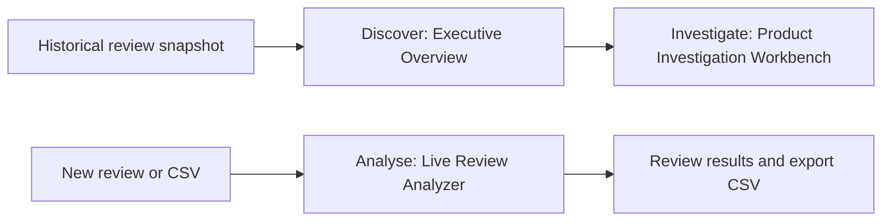

# SignalDesk: AI-Powered Customer Review Intelligence

SignalDesk helps Customer Experience Managers, Product Quality Managers and Retail Operations
Analysts find recurring concerns in appliance reviews. Star ratings summarise satisfaction but
rarely explain what went wrong; reading every review individually makes patterns difficult to see.
Trained sentiment classification, independent complaint detection and historical analytics help
managers prioritise products, inspect original customer evidence and triage incoming feedback.

Developed for **NTU BC3415 Option A (Text Classification)**.

**[Run SignalDesk](#quick-start)**

## How SignalDesk Works

### 1. Discover — Executive Overview

Start with review volume, negative-rating burden and complaint patterns to identify products
requiring attention. The historical snapshot contains **22,838 reviews across 80 products**, ending
**11 September 2023**, with **38 investigation candidates**. Search products and open a candidate to
understand the feedback behind its priority.

### 2. Investigate — Product Investigation Workbench

Examine product timelines and compare complaint proportions across supported historical periods.
Rising signals highlight increases; sustained signals highlight repeated burden across two periods.
Check supporting counts, denominators and original excerpts before escalating a customer-reported
concern. Candidates support human investigation; they do not establish defects.

Negative-rating shares use rated reviews; complaint shares use scanned bodies, with minimum support.

### 3. Analyse — Live Review Analyzer

Paste an individual review or upload a UTF-8 CSV with a required `text` column and an optional
`review_id` column. Batches support **up to 100 reviews / 2 MiB** and process each review through
the same saved sentiment model and independent rules, sequentially. Inspect exact complaint excerpts
and export a spreadsheet-safe CSV. **Other / Uncategorised Feedback** flags
negative sentiment where all five complaint scans completed without matching evidence, prompting
manual review.



**Historical analysis and incoming-review analysis are separate processing paths.** CSV uploads do
not update the historical dashboard or create investigation candidates.

For example, a manager can inspect a historical arrival-damage candidate, compare its reporting
periods and read the evidence, then separately analyse a new customer-service CSV and export
results for follow-up. This is an illustrative workflow.

## Quick Start

### 1. Install prerequisites

Use **Windows 10/11 x64** with [Python 3.13](https://www.python.org/downloads/)
(including the `py` launcher), [Node.js 24](https://nodejs.org/en/download) and
[Git for Windows](https://git-scm.com/downloads/win). Setup uses Windows' bundled `curl.exe`.

For the default **weighted DistilBERT** model, use a compatible NVIDIA GPU and driver.
The reference machine has an RTX 4070 Laptop GPU with 8 GB VRAM. The locked PyTorch
wheel includes the CUDA 12.6 runtime; no separate CUDA Toolkit is needed.

### 2. Clone and install the complete application

Open PowerShell and run:

```powershell
git clone https://github.com/RohanR2501/signaldesk-bc3415-submission.git
cd signaldesk-bc3415-submission
powershell.exe -NoProfile -ExecutionPolicy Bypass -File .\setup.ps1
```

Setup installs locked Python/frontend dependencies and automatically downloads **both**
runtime bundles from this repository's public Releases:

- [Saved sentiment models](https://github.com/RohanR2501/signaldesk-bc3415-submission/releases/tag/runtime-models-v1).
- [Frozen historical analytics data](https://github.com/RohanR2501/signaldesk-bc3415-submission/releases/tag/historical-data-v1).

Archive and extracted-file sizes/SHA256 checksums are verified before use. Valid existing
files are preserved; downloaded archives are cached in `.runtime`. No GitHub sign-in,
API key, manual file transfer, data reconstruction or retraining is required.

### 3. Launch SignalDesk

From the cloned repository folder, start the backend in PowerShell window 1:

```powershell
powershell.exe -NoProfile -ExecutionPolicy Bypass -File .\start.ps1 Backend
```

Open a second PowerShell window in the same folder and start the frontend:

```powershell
powershell.exe -NoProfile -ExecutionPolicy Bypass -File .\start.ps1 Frontend
```

Open **[http://127.0.0.1:5173](http://127.0.0.1:5173)**. Keep both service windows open;
errors remain visible in their terminals. To stop SignalDesk, press **Ctrl+C in each
window**. Stop services before rerunning setup.
API documentation: [http://127.0.0.1:8000/docs](http://127.0.0.1:8000/docs).

**CPU-only alternative:** use `setup.ps1 -CpuOnly` after cloning, then add `-CpuOnly`
to backend startup. The frontend command is unchanged:

```powershell
powershell.exe -NoProfile -ExecutionPolicy Bypass -File .\setup.ps1 -CpuOnly
powershell.exe -NoProfile -ExecutionPolicy Bypass -File .\start.ps1 Backend -CpuOnly
```

CPU mode retains all historical views and uses saved balanced Logistic Regression for
sentiment. It is a different classifier and can produce different predictions.
Initial CUDA model loading may take several minutes; subsequent requests reuse it.

### 4. Check the three views

1. **Executive Overview:** inspect **22,838 historical reviews across 80 products**.
2. **Product Investigation Workbench:** explore **38 historical candidates**, compare
   reporting periods and open original supporting customer reviews.
3. **Live Review Analyzer:** choose **Single Review**, paste
   `The coffee maker arrived broken and does not turn on.` and select **Analyse review**.
   The result shows the actual sentiment model and independent complaint evidence.
   **Batch CSV Analysis** accepts UTF-8 CSV with a `text` header, up to **100 reviews / 2 MiB**.


### Runtime files and optional modes

The [runtime inventory](config/runtime-artifacts.json) lists all required paths, byte sizes,
file hashes and archive download URLs. The historical bundle supplies the four original
prepared files, including compatible exclusion/provenance metadata. No annotation CSVs,
completed human judgments or training/test partitions are installed.

`setup.ps1 -VerifyOnly` checks existing files without downloading/installing anything.
Add `-CpuOnly` for a CPU installation. `-AnalyzerOnly` skips historical delivery and
verification for an intentionally Analyzer-only setup.

## Dataset and Machine Learning

The project uses the **Appliances** category of McAuley Lab's **Amazon Reviews 2023**. Sentiment
targets are rating-derived: **1–2 stars negative, 3 neutral, 4–5 positive**. Only original
review-body `model_text` enters classifiers; ratings, IDs, timestamps and other metadata are
excluded from sentiment features.

Preprocessing validates text, ratings and UTC timestamps, removes reviewer identities and images,
and groups exact and defined near-duplicate text families before selecting one representative per
sentiment family. Chronological splitting approximates prediction on later reviews while preventing
detected duplicate families from crossing partitions. TF-IDF vocabulary/IDF and class weights are
fitted using training data only.

Naive Bayes provides a simple TF-IDF baseline. Logistic Regression learns discriminative word/phrase
weights, with a balanced variant giving minority classes more influence. Two DistilBERT models
fine-tune the same pretrained encoder for two epochs, comparing unweighted loss with training-only
square-root inverse-frequency class weighting.

All models below use the same **6,673 rating-proxy validation reviews**, after reserving 240
annotation records. **Macro-F1** weights the three classes equally during selection, so the large
positive class cannot dominate the overall comparison.

| Model | Validation accuracy | Macro-F1 |
|---|---:|---:|
| Majority class | 76.19% | 0.2883 |
| TF-IDF + Naive Bayes | 78.30% | 0.3569 |
| TF-IDF + Logistic Regression | 87.53% | 0.5680 |
| TF-IDF + balanced Logistic Regression | 82.65% | 0.6269 |
| Unweighted DistilBERT | 89.84% | 0.6669 |
| **Weighted DistilBERT — default CUDA model** | **87.97%** | **0.6756** |

Weighted DistilBERT achieved the highest validation Macro-F1 and remains the provisional GPU model.
Its advantage over unweighted DistilBERT is modest (**0.0087 Macro-F1**), with lower overall
accuracy. Balanced Logistic Regression is the saved CPU fallback. These scores measure rating-proxy
agreement, not independently verified sentiment accuracy. The 6,921-review test set remains sealed.
Separate LLM-generated references and 20 deliberately selected human judgments do not establish
population-level performance.

## Technical Architecture

The **React / strict TypeScript** frontend calls one **FastAPI** backend through `/api/v1`. Saved
sentiment models load locally on demand and are reused. Separate modules handle preparation, offline
training/evaluation and runtime inference. [Canonical Python
contracts](backend/src/signaldesk/contracts.py) define API schemas and generate shared TypeScript
types.

Independent **complaint-rules-v2** scans five categories: **product defect, arrival damage, wrong
item, delivery issue and service/returns**. It preserves exact original-text offsets, handles
negation and records reported resolutions. Positive sentiment can coexist with complaint evidence;
no matching rule means unknown. Rule coverage is not an independently validated defect-detection
rate.

Historical time-series analytics use a cached **Polars** snapshot, calendar comparisons, explicit
denominators and minimum-support rules to prioritise reading. Historical negative-rating burden
comes from ratings, independently of live sentiment inference. Core predictions require no external
LLM service or paid inference API.

```text
backend/src/signaldesk/   FastAPI, inference orchestration and historical analytics
frontend/src/            Three views, typed client and CSV workflow
ml/signaldesk_data/      Acquisition, validation, deduplication and partitions
ml/signaldesk_ml/        Sentiment experiments, evaluation, inference and complaint rules
config/                  Experiment configuration and runtime artifact inventory
docs/                    API schema and complaint taxonomy
scripts/                 Model-cache, GPU-check and contract-export utilities
tests/; frontend/tests/  Focused backend and CSV-processing tests
setup.ps1; start.ps1     Windows installation and foreground service helpers
```

## Business Value and Future Integration

SignalDesk supports incoming-review triage, prioritises recurring product concerns and provides
traceable evidence for investigation and escalation. Companies can analyse their own reviews and CSV
batches today within the existing limits and appliance-review domain. Outputs support human
decisions; the application does not autonomously issue refunds, recalls or verified defect findings.

Refreshing dashboards from company time-stamped records requires additional ingestion/preparation,
product mapping and compatible provenance. This can be implemented as a future integration.

## Troubleshooting and Data Attribution

- **Historical views unavailable:** stop services and rerun `setup.ps1` to retrieve and
  verify the historical Release. Check that `-AnalyzerOnly` was not selected. Restart
  the backend after correcting files; no research preparation is needed.
- **Sentiment unavailable or fallback used:** check paths against the runtime inventory
  and inspect the displayed model/device. For CPU use, add `-CpuOnly` to setup and backend
  startup. Restart the backend after correcting artifacts or dependencies.
- **Slow first analysis:** allow several minutes for initial CUDA loading. A connected
  health status confirms API liveness, not completed model initialization.
- **Port 8000 or 5173 occupied:** use the existing service or stop it in its own terminal.
  Startup helpers do not terminate processes. Stop the frontend before rerunning setup.
- **Download or checksum failure:** check GitHub/network access and the reported path.
  Restore the trusted matching file; setup refuses to overwrite conflicting files.

**Dataset:** McAuley Lab, [Amazon Reviews 2023](https://amazon-reviews-2023.github.io/). Hou et al.
(2024), *Bridging Language and Items for Retrieval and Recommendation*. The [maintainers' usage
clarification](https://huggingface.co/datasets/McAuley-Lab/Amazon-Reviews-2023/discussions/1) does
not assign a dataset licence. The historical Release includes the frozen source-review
bodies and reservation metadata for reproducibility; it grants no new rights in Amazon text.
Completed annotations and research partitions remain excluded. Applicable third-party rights
remain unresolved.

**Base model:** [distilbert-base-uncased](https://huggingface.co/distilbert/distilbert-base-uncased), Apache-2.0.
The Release retains its licence and identifies project fine-tuning. That licence does not resolve
Amazon dataset or downstream training-data rights. Only load trusted joblib files.
